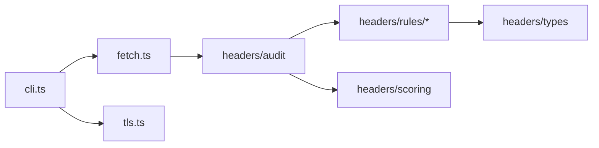

# hx-http-security-cli — architecture

## Purpose

Fetches HTTP(S) resources, evaluates response headers against security rules, follows
redirect chains for visibility, and optionally inspects TLS certificates on a TCP
connection. Non-goals: full DAST, JavaScript analysis, or WAF bypass.

## High-level flow

## Module map

| Path                               | Responsibility                                   |
| ---------------------------------- | ------------------------------------------------ |
| `src/cli.ts`                       | `audit`, `chain`, `tls` commands and exit policy |
| `src/index.ts`                     | Public API re-exports                            |
| `src/fetch.ts`                     | Redirect-following fetch, URL normalization      |
| `src/tls.ts`                       | Direct TLS socket certificate inspection         |
| `src/headers/audit.ts`             | Run all header rules, assemble findings          |
| `src/headers/scoring.ts`           | Map findings to 0–100 score                      |
| `src/headers/types.ts`             | Finding and audit result types                   |
| `src/headers/utils.ts`             | Header name/value helpers                        |
| `src/headers/rules/index.ts`       | Rule registry                                    |
| `src/headers/rules/csp.ts`         | Content-Security-Policy checks                   |
| `src/headers/rules/hsts.ts`        | Strict-Transport-Security checks                 |
| `src/headers/rules/clickjack.ts`   | X-Frame-Options / frame-ancestors                |
| `src/headers/rules/nosniff.ts`     | X-Content-Type-Options                           |
| `src/headers/rules/referrer.ts`    | Referrer-Policy                                  |
| `src/headers/rules/permissions.ts` | Permissions-Policy                               |
| `src/headers/rules/disclosure.ts`  | Server / X-Powered-By disclosure                 |

## Extension

1. Add a rule module under `headers/rules/` and register it in `rules/index.ts`.
2. Adjust weighting in `headers/scoring.ts` if the rule affects the score.
3. Unit-test rules with static header maps — no live fetch in `*.spec.ts`.
4. Run `npm test` and `npm run format:check`.

## Testing strategy

- **Unit**: per-rule specs, scoring, fetch redirect logic (mocked).
- **Integration**: `jest.integration.config.js` — optional live URLs.

## Ethics & scope

Authorized engagements only. See [SECURITY.md](./SECURITY.md).
